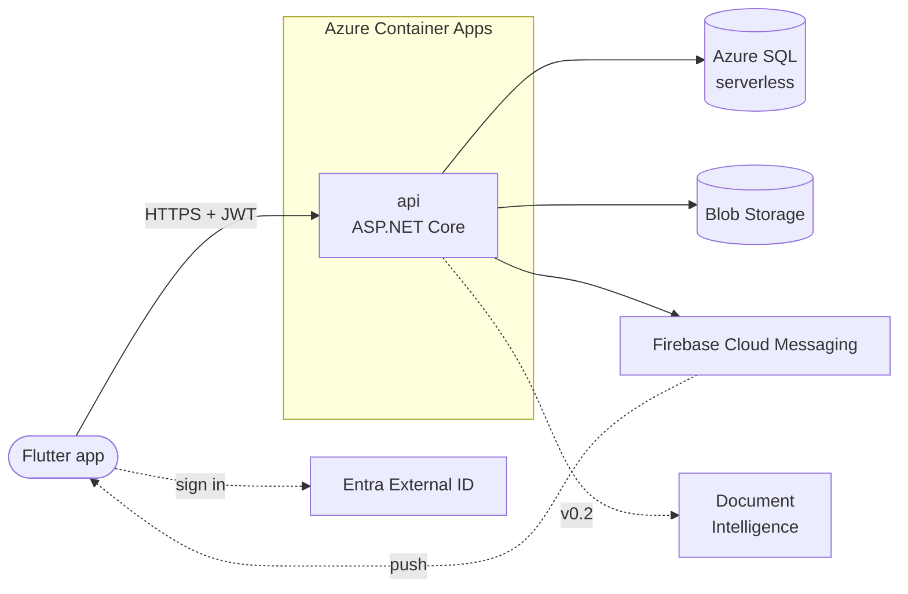

# Peary

A shared space for families (and any small group) to get organised: who does what and when, where everyone is,
and the receipts and documents that come with it, all in one app.

Built as a portfolio project with **.NET 10, Flutter, Azure SQL, Azure Container Apps and Microsoft Entra External
ID**, deployed with Bicep and GitHub Actions.

> **Status: planning.** The scope and the first decisions are in [docs/roadmap.md](docs/roadmap.md) and
> [docs/adr/](docs/adr/).

## What it does

- **Groups**: anyone can sign up, create a group (a family, a shared flat) and invite others. A person can belong
  to several groups.
- **Tasks**: who does what and when (do the shopping, empty the dryer, the dentist), with reminders and push
  notifications.
- **Shopping list**: a task that carries its own list, ticked off in real time by whoever is at the shop.
- **Receipts and documents**: photos and PDFs attached to a task or kept in the group's documents. Receipts are read
  with AI, so the group can see what it spends and where without linking any bank.
- **Places and location**: places on a map (home, school, Roberto's work) and, at a glance, who is at which one.

## Architecture

The backend follows a light **Clean Architecture** (`Domain`, `Application`, `Infrastructure`, `Api`). Locally,
**Aspire** starts everything with one command.

## How it's built

Two AI agents, Claude Code and Gemini CLI, build it in parallel under the owner's direction: the rules they share
are in [AGENTS.md](AGENTS.md), and the HTTP contract in [docs/api.md](docs/api.md) is what lets the backend and
the app move independently.
